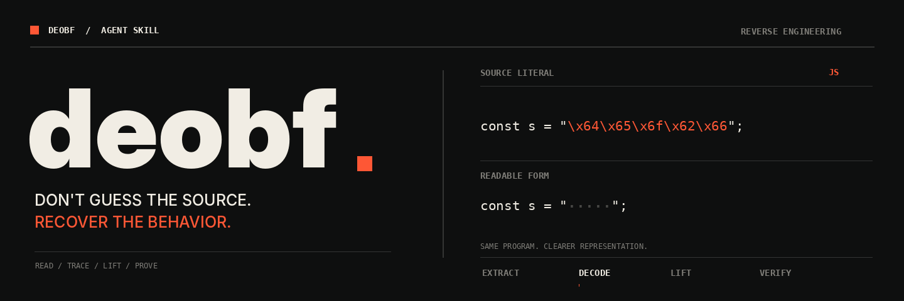

<p align="center">
  
</p>

<h1 align="center">deobf</h1>
<p align="center"><strong>Don't guess the source. Recover the behavior.</strong></p>
<p align="center">
  <a href="#the-problem">The problem</a> ·
  <a href="#the-method">The method</a> ·
  <a href="#install">Install</a> ·
  <a href="SKILL.md">Read the skill</a>
</p>

---

## The problem

A model can decode a string, rename a dispatcher, write three suspiciously neat functions, and call it *fully deobfuscated*.

That isn't reverse engineering. It's a plausible story about a program.

**`deobf` makes the agent prove its way through the layers.** It pushes for actual format recovery, reusable decoders, instruction semantics, control-flow reconstruction, and behavior checks. If something cannot be recovered, it stays unresolved instead of being made up.

One `SKILL.md`. No runtime dependency. No giant prompt framework.

## The method

```text
INPUT
  │
  ├── extract      identify containers, loaders, formats, and runtime
  ├── decode       recover bytes, constants, prototypes, and instructions
  ├── lift         translate semantics, remove VM state, recover control flow
  └── verify       test behavior and mark every unresolved boundary
  │
  └── RECOVERED ARTIFACTS + REPRODUCIBLE PIPELINE
```

| Bad habit | Required approach |
| :--- | :--- |
| "Looks like Base64" | Identify and test the actual decoding routine |
| Rewriting a few functions manually | Build a transform that covers the relevant program |
| Renaming a VM dispatcher | Recover handler semantics and the execution model |
| Pretending unknown opcodes are no-ops | Keep unresolved instructions explicit |
| Dumping instructions once | Account for lazy decoding and runtime mutation |
| "Compiles, so it's recovered" | Check behavior, side effects, and relevant paths |
| Reconstructing what the code *probably* did | Separate observed facts, hypotheses, and verified results |

**A prettier VM is still a VM. A runnable guess is still a guess.**

## What it covers

- **Lua / LuaJIT / Luau** — escaped strings, layered loaders, prototypes, virtualized bytecode, environment and metamethod semantics.
- **JavaScript** — string arrays, dynamic evaluation, control-flow flattening, coercion and signed-integer edge cases.
- **Native binaries** — PE/ELF/Mach-O structures, packing vs virtualization, relocations, imports, entry points, reconstructed-image validation.
- **Custom virtual machines** — dispatch, operand tables, register or stack models, handler lifting, control-flow recovery, mutable state.

The same core rule applies everywhere: establish the contract before transforming the representation.

## Install

Copy [`SKILL.md`](SKILL.md) into your agent's skills directory:

| Agent | Project-local | User-wide |
| :--- | :--- | :--- |
| **Codex** | `.agents/skills/deobf/SKILL.md` | `~/.agents/skills/deobf/SKILL.md` |
| **Claude Code** | `.claude/skills/deobf/SKILL.md` | `~/.claude/skills/deobf/SKILL.md` |

Or use another client compatible with the [Agent Skills specification](https://agentskills.io/specification). Start a fresh agent session after installing, and explicitly mention `deobf` if your agent doesn't activate it automatically.

### Example request

```text
Use deobf to analyze this Lua file.
Identify the layers and VM format before simplifying anything.
Write reusable scripts for the decoder and lifter; don't manually
rewrite individual functions. Save the outputs and report exactly
what is verified, partially recovered, and still unknown.
```

<details>
<summary><strong>What should a recovery report actually say?</strong></summary>

```text
INPUT      sample.lua (SHA-256: ...)
DECODED    literal escapes + compressed payload
FOUND      register VM, 43 distinct handlers
LIFTED     38/43 handlers with established semantics
COVERAGE   12/15 prototypes translated
VERIFIED   parser checks + 91 differential cases
UNKNOWN    5 handlers; 3 prototypes still depend on them
OUTPUT     decoded.lua, lifted.partial.lua, tools/recover.py
```

Those are illustrative numbers, not results from a real sample. The point is to report measurable coverage, explicit unknowns, and the exact validation performed — not to write "100% deobfuscated" above unfinished code.

</details>

## What this is / isn't

**It is:** an instruction-only skill for methodical, tool-assisted deobfuscation. It encourages reversible stages, automated lifting, evidence-backed conclusions, and reproducible results.

**It isn't:** a universal unpacker, a devirtualizer executable, a malware sandbox, or a guarantee that any given model can recover a protected program. A skill improves the workflow; it doesn't invent missing evidence or tools. Only analyze software you have the right to examine, and treat unknown samples as untrusted.

The instructions are in **[`SKILL.md`](SKILL.md)**. Audit them, change them, improve them.

---

<sub>MIT licensed. See <a href="LICENSE">LICENSE</a>.</sub>
